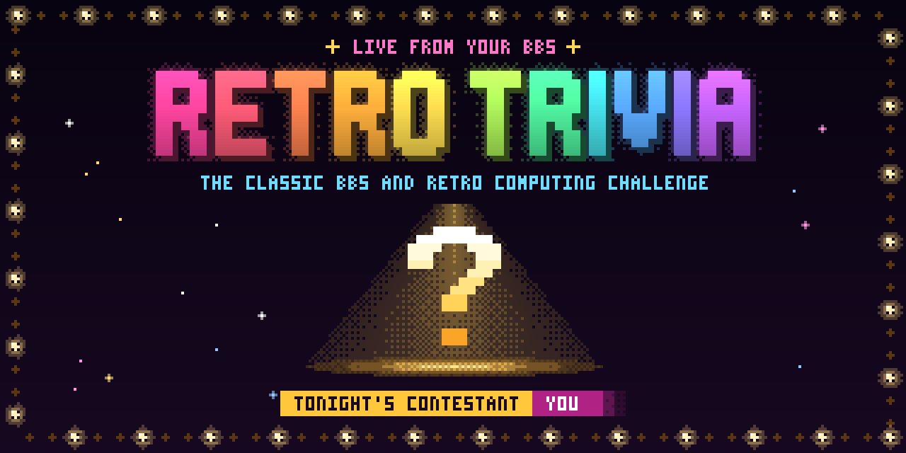

# Retro Trivia

A quick, single-player trivia door game for BBSes. Pick a round of 5, 8, 12 or
20 questions from a bank of 251, answer each with one key, and see how you did.
Every launch is a fresh round; nothing is saved between calls.

Retro Trivia is **one Python file** (`retro_trivia.py`) with no dependencies
beyond the standard library. It needs Python 3.11 or newer and a terminal of at
least 40×12.

## Where it runs

- **NetBBS:** bundled. NetBBS ships a tagged release of this file
  (Thiesi/NetBBS#1226), so a NetBBS SysOp has nothing to install.
- **Other BBS software** (Synchronet, Mystic, ENiGMA½, …): reads DOOR32.SYS
  and DOOR.SYS caller metadata, with CP437 or UTF-8 output and stdio or
  inherited DOOR32 sockets. An ANSI-capable terminal/bridge is required.
  Real-host validation (#5) is still pending.
- **Standalone**, for trying it out: `python3 retro_trivia.py`.

## SysOp setup

Install Python 3.11+ and copy `retro_trivia.py` to your door directory. Pass
the caller's drop-file **filename**, quoting paths that contain spaces:

```sh
python3 /opt/doors/retrotrivia/retro_trivia.py "/path/to/node/DOOR.SYS"
```

`DOOR32.SYS` also works. The reader accepts case-insensitive format names,
renamed files detected by their contents, LF/CRLF endings, and UTF-8 or CP437
metadata. It uses the alias (falling back to the real name), defaults to
16 colours and an 80-column display, and reads the height from DOOR.SYS.
DOOR32 defaults to 24 rows and supplies the BBS name; DOOR.SYS and standalone
launches display `Local`. Control characters and terminal escape sequences
are removed from imported names before any screen uses them.

`NETBBS_DOOR_INFO` takes precedence, even when its JSON file cannot be read.
NetBBS keeps its existing host defaults and colour selection. An unreadable
or malformed classic file emits a warning to stderr and starts with Guest,
Local, 80×24 and 16-colour defaults. No session data is saved.

Foreign drop files default to **CP437 output**. Use `--encoding utf-8` for a
UTF-8 terminal/bridge, or `--encoding cp437` to force CP437 when trying the
game standalone. `--encoding auto` is the default: CP437 with a classic drop
file, UTF-8 otherwise. NetBBS always receives UTF-8, even with an override,
because NetBBS handles its caller's encoding itself.

The following recipes use **standard input/output**. The host must forward
single keys and match the game's output encoding. For DOOR32 stdio launches,
set the communications type to local (`0`); type `2` selects a socket.
These recipes await the field tests in #5.

| Host | Stdio launch configuration |
| --- | --- |
| Synchronet on Linux | In SCFG → Online Programs, enable Native Executable/Script, select Standard I/O, choose DOOR.SYS and put drop files in the Node Directory. Command line: `/usr/bin/python3 /opt/doors/retrotrivia/retro_trivia.py "%f"`. This uses CP437; add `--encoding utf-8` for a UTF-8 stdio configuration. |
| Mystic on Linux/macOS | Use the `DD` external-program menu action with `/usr/bin/python3 /opt/doors/retrotrivia/retro_trivia.py "%PDOOR.SYS"`. `%P` includes the trailing slash. This uses CP437; add `--encoding utf-8` for UTF-8 callers. |
| ENiGMA½ | Add an `abracadabra` menu entry as below; `encoding: cp437` matches the game's default. For UTF-8, set it to `utf8` and add `"--encoding", "utf-8"` to `args`. |

```hjson
doorRetroTrivia: {
    desc: Retro Trivia
    module: abracadabra
    config: {
        name: RetroTrivia
        dropFileType: DOOR
        cmd: /usr/bin/python3
        args: [ "/opt/doors/retrotrivia/retro_trivia.py", "{dropFilePath}" ]
        io: stdio
        encoding: cp437
    }
}
```

Host references: [Synchronet door configuration](https://wiki.synchro.net/howto:door:index),
[Mystic external programs](https://wiki.mysticbbs.com/doku.php?id=menu_commands#external_doors),
and [ENiGMA½ scripts and native binaries](https://enigma-bbs.github.io/doors/scripts-and-binaries/).

For a native **DOOR32 socket launch** on Windows or POSIX, pass the same
drop-file path and configure the host to inherit the caller's connected
socket. DOOR32 line 1 must be `2`; line 2 contains the inherited Winsock
handle on Windows or descriptor on POSIX. Input and output then use that
socket, including the splash. The door filters telnet commands, escapes
outgoing IAC bytes and recognizes CR NUL/CR LF as one Enter key. Carrier loss
exits cleanly; returning from the door closes its handle without shutting
down the host's connection. An invalid handle reports an error instead of
silently starting a stdio game. NetBBS always retains its stdio transport.

An ENiGMA½ `io: socket` callback server is a different launch mechanism;
use its stdio recipe above. Real Windows Synchronet validation remains #5.

## Development

```sh
python -m pip install pytest pytest-xdist
python -m pytest -n auto              # the suite
python tools/check_stdlib_only.py     # the door imports only the standard library
```

Retro Trivia was developed inside NetBBS until October 2026. Its history came
along, but issue numbers in older commits and comments refer to
[Thiesi/NetBBS](https://github.com/Thiesi/NetBBS) issues.

## Releases

Pushing a tag such as `v1.0.0` runs the suite and publishes that commit's
`retro_trivia.py`, byte-for-byte as stored in git, with a `SHA256SUMS` file.
NetBBS vendors these releases.

The banner is drawn from the game's own launch splash by `art/render_banner.py`.
The CP437 screen preview can be regenerated with
`python art/render_terminal_preview.py` (development-only dependencies: Pillow
and pyte; `--font` accepts a monospace TrueType font).

## License

BSD 2-Clause, see [LICENSE](LICENSE).
